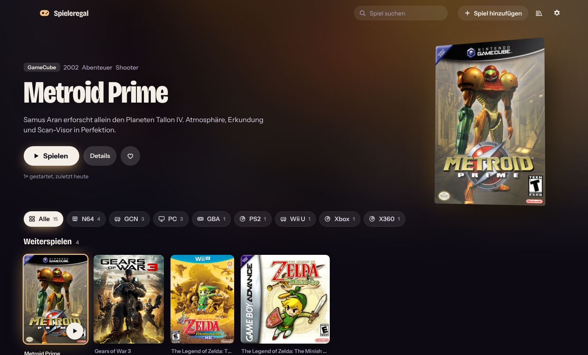
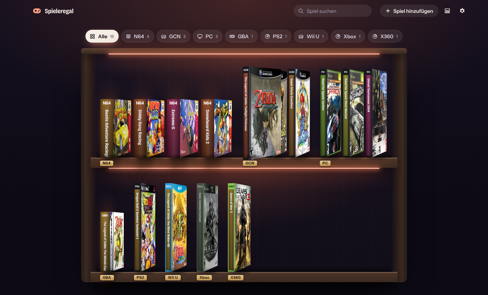
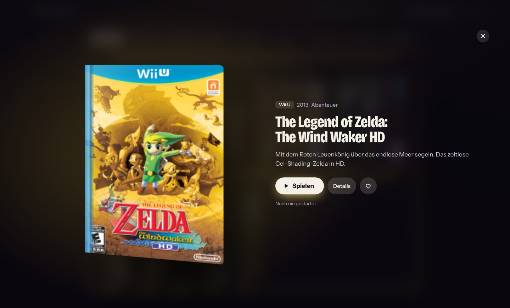
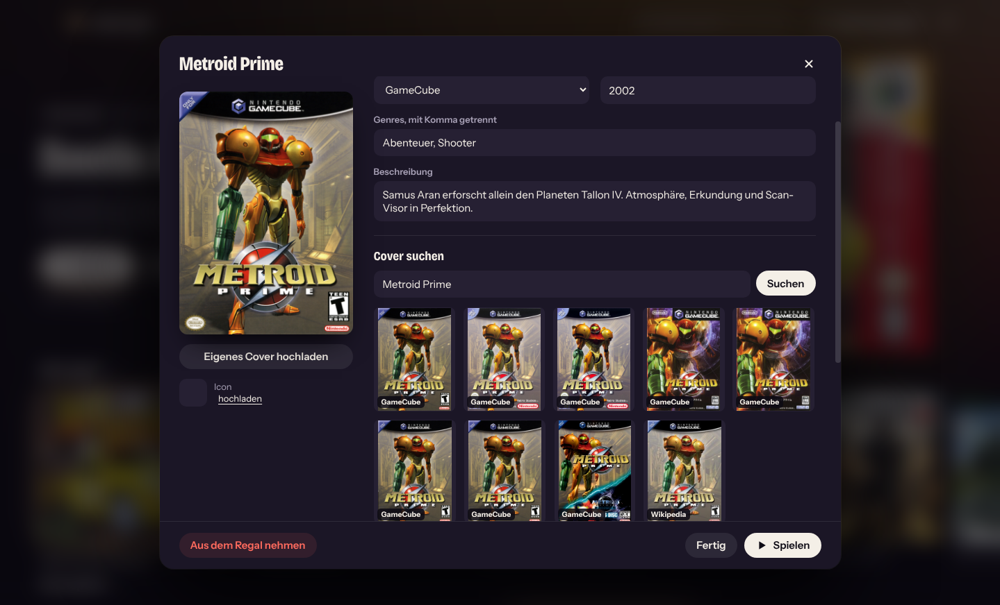
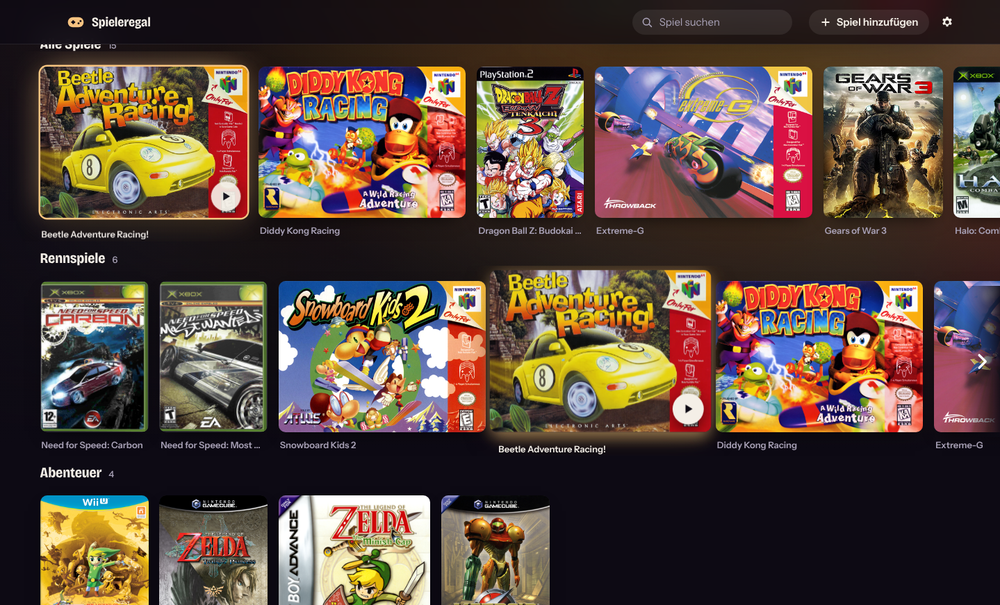
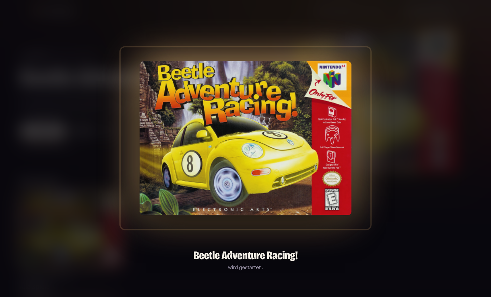

<p align="center">
  
</p>

<h1 align="center">Spieleregal</h1>

<p align="center">
  Ein Game Launcher für macOS, der die eigenen Spiele wie eine Mediathek zeigt:<br>
  große Cover, Regale zum Stöbern und ein Klick bis zum Spiel.
</p>

<p align="center">
  
</p>

## Was es kann

- **Bühne und Regale.** Das gewählte Spiel steht groß oben, mit 3D-Cover, Beschreibung und „Spielen“. Darunter Regale für „Weiterspielen“, Favoriten, alle Spiele, Genres und Plattformen. Der Hintergrund nimmt die Farbe des Covers an.
- **Regal-Ansicht.** Statt der Mediathek ein beleuchtetes Regal: Die Spiele stehen als 3D-Hüllen mit dem Rücken nach vorn, in Maßen und Farben ihrer Plattform (schwarze GameCube-Hülle, hellblaue Wii-U-Hülle, grüne Xbox-Hülle, N64-Karton). Beim Überfahren schiebt sich eine Hülle heraus, ein Klick zieht sie ganz aus dem Regal. Umschalten über den Knopf neben dem Zahnrad oder in den Einstellungen.
- **Plattform-Filter.** Ein Klick auf „N64“, „GCN“ oder „PC“ zeigt nur die Spiele dieser Plattform. Die Filter entstehen aus der eigenen Sammlung.
- **Artwork groß ansehen.** Ein Klick auf ein Cover holt das Spiel auf die Bühne und scrollt sanft nach oben.
- **macOS-Widget.** Ein echtes Widget für Schreibtisch und Mitteilungszentrale (mittel und groß) mit den zuletzt gespielten Spielen. Ein Klick aufs Cover startet das Spiel. Installation: Einstellungen, „macOS-Widget“, „Installieren“. Der Launcher baut es dann mit Xcode und legt es unter `~/Applications/Spieleregal Widget.app` ab.
- **Schwebendes Widget-Fenster.** Dasselbe als breites Fenster der App, ohne Xcode. Ein- und ausschalten in den Einstellungen oder mit ⇧⌘W.
- **Verschobene Spiele.** Liegt ein Spiel nicht mehr am alten Ort, sucht der Launcher es unter demselben Namen in den eingestellten Spiele-Ordnern.
- **Starten.** Per „Spielen“, Doppelklick oder Eingabetaste. Apps, Ordner und Startdateien funktionieren; bei Ordnern sucht der Launcher die App darin.
- **Spiele hinzufügen.** Über „Spiel hinzufügen“ oder per Ziehen ins Fenster. Cover und App-Icon werden automatisch geholt.
- **Cover und Icons.** Suche über mehrere Quellen, eigenes Bild hochladen oder hineinziehen, Icon austauschen.
- **Bedienung.** Suche, Rechtsklick-Menü, Pfeiltasten und Gamepad.

| Regal-Ansicht | Hülle herausgezogen |
| --- | --- |
|  |  |

| Plattform-Filter | Details und Cover-Suche |
| --- | --- |
|  |  |

<p align="center">
  <br>
  <sub>Das schwebende Widget-Fenster. Das macOS-Widget zeigt dieselben Spiele im System-Look.</sub>
</p>

<p align="center">
  
</p>

<p align="center">
  
</p>

## macOS-Widget

Ein echtes WidgetKit-Widget für Schreibtisch und Mitteilungszentrale, in mittlerer Größe mit vier und in großer mit acht Covern. Es liest dieselbe Bibliothek wie der Launcher und zeigt die zuletzt gespielten Spiele.

**Installieren**

1. Xcode installieren (macOS 14 oder neuer).
2. Im Launcher die Einstellungen öffnen (⌘,) und bei „macOS-Widget“ auf „Installieren“ klicken. Der Bau dauert etwa eine Minute.
3. Rechtsklick auf den Schreibtisch, „Widgets bearbeiten“, „Spieleregal“ suchen und ablegen.

**Wie es funktioniert**

| Teil | Aufgabe |
| --- | --- |
| `app/widget/Widget/` | Das Widget selbst (SwiftUI). Läuft in der Sandbox und darf nur die Bibliothek des Launchers lesen. |
| `app/widget/Host/` | Kleines Trägerprogramm ohne Fenster. Nimmt Klicks aus dem Widget entgegen und reicht sie an den Launcher weiter. |
| `app/widget/build.sh` | Baut beides mit `xcodebuild`, signiert mit einem vorhandenen „Apple Development“-Zertifikat (sonst lokal) und legt das Ergebnis unter `~/Applications/Spieleregal Widget.app` ab. |

Ein Klick aufs Cover öffnet `spieleregal://launch/<id>`. Das Trägerprogramm macht daraus `spieleregal-launcher://…`, und der Launcher startet das Spiel, ohne sein Fenster zu zeigen. Ändert sich die Bibliothek, sagt der Launcher dem Widget Bescheid, damit es neu zeichnet.

Ohne Xcode gibt es das schwebende Widget-Fenster als Ersatz.

## Cover-Quellen

| Quelle | Anmeldung | Gut für |
| --- | --- | --- |
| [libretro-Thumbnails](https://thumbnails.libretro.com) | keine | Boxarts für Konsolenspiele |
| Steam | keine | PC-Spiele |
| Wikipedia | keine | alles, was sonst fehlt |
| [SteamGridDB](https://www.steamgriddb.com) | kostenloser API-Schlüssel | größte Auswahl, hochauflösend |

Den SteamGridDB-Schlüssel trägst du in den Einstellungen ein (⌘,).

## Bauen

Voraussetzung: macOS. Node oder npm braucht es nicht. Für das macOS-Widget zusätzlich Xcode (ab macOS 14).

```bash
./scripts/build.sh
open "Game Launcher.app"
```

Das Skript lädt Electron, legt `app/` hinein und setzt Name und Icon. Das Ergebnis ist `Game Launcher.app` im Projektordner und lässt sich nach `/Applications` ziehen.

## Bedienung

| Aktion | Maus | Tastatur | Gamepad |
| --- | --- | --- | --- |
| Ansicht wechseln (Mediathek, Regal) | Knopf neben dem Zahnrad | | |
| Spiel wählen und groß ansehen | Klick aufs Cover | Pfeiltasten | Steuerkreuz, Stick |
| Spielen | Doppelklick, Play-Knopf | Eingabe | A |
| Details | „Details“, Rechtsklick | Leertaste | Y |
| Favorit | Herz | F | X |
| Suchen | Suchfeld | ⌘F oder / | |
| Spiel hinzufügen | Knopf, Ziehen ins Fenster | ⌘N | |

## Aufbau

```
app/
  main.js        Bibliothek, Spielstart, Icons aus .app-Bündeln
  covers.js      Cover-Quellen und Trefferbewertung
  preload.js     Brücke zwischen Oberfläche und Hauptprozess
  renderer/      Oberfläche (Mediathek, Regal) und Widget-Fenster (HTML, CSS, JavaScript ohne Framework)
  widget/        macOS-Widget (SwiftUI, WidgetKit) samt Xcode-Projekt und Bauskript
  seed/          Startbibliothek mit Covern
scripts/build.sh Baut die Mac-App
test/harness.js  Testlauf mit Screenshots
```

Die Bibliothek liegt in `~/Library/Application Support/Game Launcher/` (`library.json`, Cover, Icons). Wer den Ordner löscht, startet wieder mit der Auswahl aus `app/seed/seed.json`. Dort stehen auch die Pfade der Spiele; für eine eigene Sammlung passt du die Datei an oder fügst Spiele in der App hinzu.

## Hinweis

Cover und Logos gehören den jeweiligen Rechteinhabern. Dieses Projekt ist eine private Sammlung und steht in keiner Verbindung zu ihnen.
