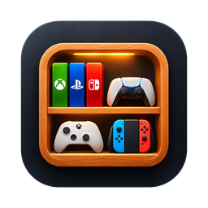
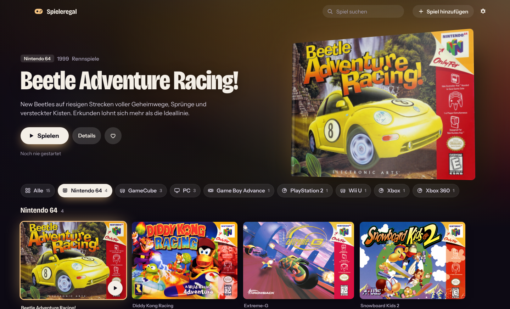
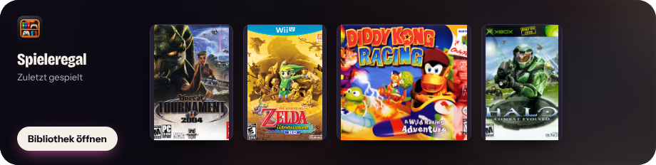

<p align="center">
  
</p>

<h1 align="center">Spieleregal</h1>

<p align="center">
  Ein Game Launcher für macOS, der die eigenen Spiele wie eine Mediathek zeigt:<br>
  große Cover, Regale zum Stöbern und ein Klick bis zum Spiel.
</p>

<p align="center">
  
</p>

## Was es kann

- **Bühne und Regale.** Das gewählte Spiel steht groß oben, mit 3D-Cover, Beschreibung und „Spielen“. Darunter Regale für „Weiterspielen“, Favoriten, alle Spiele, Genres und Plattformen. Der Hintergrund nimmt die Farbe des Covers an.
- **Plattform-Filter.** Ein Klick auf „Nintendo 64“, „GameCube“ oder „PC“ zeigt nur die Spiele dieser Plattform. Die Filter entstehen aus der eigenen Sammlung.
- **Artwork groß ansehen.** Ein Klick auf ein Cover holt das Spiel auf die Bühne und scrollt sanft nach oben.
- **Widget.** Ein breites Fenster für den Schreibtisch zeigt die zuletzt gespielten Spiele. Ein Klick aufs Cover startet das Spiel, „Bibliothek öffnen“ holt den Launcher nach vorn. Ein- und ausschalten in den Einstellungen oder mit ⇧⌘W.
- **Verschobene Spiele.** Liegt ein Spiel nicht mehr am alten Ort, sucht der Launcher es unter demselben Namen in den eingestellten Spiele-Ordnern.
- **Starten.** Per „Spielen“, Doppelklick oder Eingabetaste. Apps, Ordner und Startdateien funktionieren; bei Ordnern sucht der Launcher die App darin.
- **Spiele hinzufügen.** Über „Spiel hinzufügen“ oder per Ziehen ins Fenster. Cover und App-Icon werden automatisch geholt.
- **Cover und Icons.** Suche über mehrere Quellen, eigenes Bild hochladen oder hineinziehen, Icon austauschen.
- **Bedienung.** Suche, Rechtsklick-Menü, Pfeiltasten und Gamepad.

| Plattform-Filter | Details und Cover-Suche |
| --- | --- |
|  |  |

<p align="center">
  
</p>

<p align="center">
  
</p>

<p align="center">
  
</p>

## Cover-Quellen

| Quelle | Anmeldung | Gut für |
| --- | --- | --- |
| [libretro-Thumbnails](https://thumbnails.libretro.com) | keine | Boxarts für Konsolenspiele |
| Steam | keine | PC-Spiele |
| Wikipedia | keine | alles, was sonst fehlt |
| [SteamGridDB](https://www.steamgriddb.com) | kostenloser API-Schlüssel | größte Auswahl, hochauflösend |

Den SteamGridDB-Schlüssel trägst du in den Einstellungen ein (⌘,).

## Bauen

Voraussetzung: macOS. Node oder npm braucht es nicht.

```bash
./scripts/build.sh
open "Game Launcher.app"
```

Das Skript lädt Electron, legt `app/` hinein und setzt Name und Icon. Das Ergebnis ist `Game Launcher.app` im Projektordner und lässt sich nach `/Applications` ziehen.

## Bedienung

| Aktion | Maus | Tastatur | Gamepad |
| --- | --- | --- | --- |
| Spiel wählen und groß ansehen | Klick aufs Cover | Pfeiltasten | Steuerkreuz, Stick |
| Spielen | Doppelklick, Play-Knopf | Eingabe | A |
| Details | „Details“, Rechtsklick | Leertaste | Y |
| Favorit | Herz | F | X |
| Suchen | Suchfeld | ⌘F oder / | |
| Spiel hinzufügen | Knopf, Ziehen ins Fenster | ⌘N | |

## Aufbau

```
app/
  main.js        Bibliothek, Spielstart, Icons aus .app-Bündeln
  covers.js      Cover-Quellen und Trefferbewertung
  preload.js     Brücke zwischen Oberfläche und Hauptprozess
  renderer/      Oberfläche und Widget (HTML, CSS, JavaScript ohne Framework)
  seed/          Startbibliothek mit Covern
scripts/build.sh Baut die Mac-App
test/harness.js  Testlauf mit Screenshots
```

Die Bibliothek liegt in `~/Library/Application Support/Game Launcher/` (`library.json`, Cover, Icons). Wer den Ordner löscht, startet wieder mit der Auswahl aus `app/seed/seed.json`. Dort stehen auch die Pfade der Spiele; für eine eigene Sammlung passt du die Datei an oder fügst Spiele in der App hinzu.

## Hinweis

Cover und Logos gehören den jeweiligen Rechteinhabern. Dieses Projekt ist eine private Sammlung und steht in keiner Verbindung zu ihnen.
